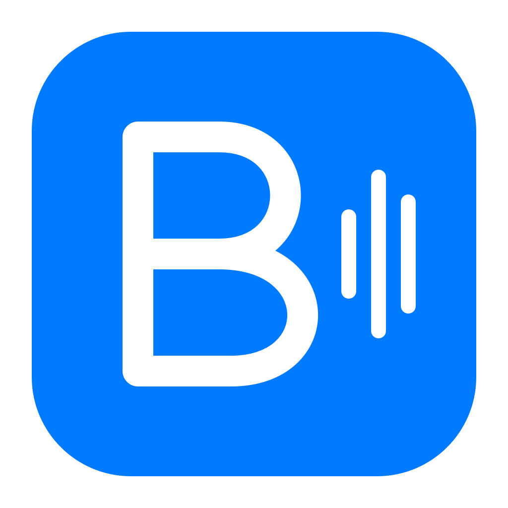

<!-- SPDX-License-Identifier: GPL-3.0-or-later -->
# BalanceEQ



A native, free macOS equalizer inspired by the workflow of Equalizer APO and Peace. SwiftUI controls sit above a small C audio engine. There are no accounts, ads, subscriptions, telemetry, installed audio drivers, or third-party runtime packages.

**1.0.0 release preparation:** the source and local build are available in this checkout. A signed public release has not been produced. See the [1.0.0 draft notes](docs/releases/1.0.0.md). Hardware audio acceptance, macOS 14.2 compatibility, and Intel runtime testing remain pending; see [the acceptance record](docs/ACCEPTANCE.md). Building successfully does not establish those results.

## Install with one command

**Ready for the first signed release:** there is currently no public release binary. Until one is published, this installer reports that no download is available and leaves your Mac unchanged.

Once a signed release is available, paste this one command into Terminal:

```sh
/bin/bash -c 'set -e; installer=$(curl -fsSL https://raw.githubusercontent.com/x5mii/BalanceEQ/main/scripts/install.sh); /bin/bash -c "$installer"'
```

The command fetches the complete [installer script](scripts/install.sh) before running it. The installer downloads the latest universal GitHub release, verifies its SHA-256 checksum, code signature, and macOS Gatekeeper approval, then installs into `~/Applications/BalanceEQ.app` and opens it. No sudo, Homebrew, Xcode, or account is needed. macOS 14.2 or later is required.

Run the same command to update; first choose **Quit BalanceEQ** from the menu bar. Updates preserve your presets and restore the previous app if replacement fails. The installer never disables Gatekeeper, removes quarantine, or grants audio permission. On first use, choose **Start EQ** and allow System Audio Recording when macOS asks.

To uninstall, quit BalanceEQ and move `~/Applications/BalanceEQ.app` to the Trash. Your presets remain in `~/Library/Application Support/EqualizerForMac`.

## Build and run

The deployment target is macOS 14.2 or later, for Apple Silicon and Intel. Building requires Xcode 26 or later, its command-line tools selected, and its license accepted. The macOS 26 SDK is needed to compile native Liquid Glass; earlier supported systems use standard materials.

```sh
./scripts/check.sh
./scripts/build-app.sh
open "build/BalanceEQ.app"
```

The build script creates a universal `arm64` + `x86_64` app by default. For a faster local Apple Silicon build, run `ARCHITECTURES=arm64 ./scripts/build-app.sh`. Local builds are **ad-hoc signed**, without a Developer ID or notarization. They are developer builds, not the intended public download.

For repeat development builds, `LOCAL_SIGNING_IDENTITY="your code-signing identity" ./scripts/build-app.sh` uses an existing persistent local certificate without a timestamp. Keep the same identity and bundle identifier between builds; ad-hoc signatures change with the executable and can cause macOS to ask for capture permission again. A public release still requires Developer ID signing and notarization. The app keeps its original `org.equalizerformac.app` identifier and `EqualizerForMac` data folder so the BalanceEQ rename preserves existing presets.

The blue B/EQ artwork is generated from the shared native vector code: `xcrun swiftc Sources/EqualizerMac/Branding.swift scripts/generate-icon.swift -o .build/generate-icon`, then `.build/generate-icon` and `iconutil -c icns .build/BalanceEQ.iconset -o Resources/BalanceEQ.icns`.

Device enumeration is available without starting capture or changing audio settings:

```sh
"build/BalanceEQ.app/Contents/MacOS/EqualizerMac" --diagnose
```

## Using the equalizer

- Start with the ten-band Flat preset, then select a band to edit frequency, gain, Q, type, or enablement. Add or remove bands, up to 32. Types are peaking, low/high shelf, low/high pass, and notch. The response graph uses the playback engine's coefficients.
- Numeric fields keep partial typing out of the live engine: enter `0.2` (or `0,2`) for Q and press Return or Tab to apply. Escape cancels; invalid numbers retain the previous setting and mark the field. This also applies to frequency, gain, and preamp.
- **Live audio** shows the actual stereo spectrum before and after EQ, using separate dashed gray and blue traces. Analysis runs only while this view is selected and the window is visible; it adds no playback queue. The 2,048-sample Hann FFT has sample-rate-dependent resolution (23.44 Hz at 48 kHz). **EQ response** shows calculated filter gain. These are digital signals, not acoustic headphone measurements: a Harman-target profile cannot by itself prove your headphone matches the Harman curve. Raw headphone/target measurements are not included in the profile catalog.
- Double-click a band gain or preamp slider to reset it to 0 dB. Drag a band's frequency number up or right to increase it, down or left to decrease it. The fields below still accept exact values.
- Choose **Start** to enable processing. macOS may request System Audio Recording permission. That permission permits the audio tap; this app processes samples in memory and does not save or upload recordings. It excludes its own playback and disables unused physical input streams. macOS still shows its audio-capture privacy indicator during processing; that indicator is not another permission request. The app never resets permissions or tries to hide system privacy controls.
- The app follows the macOS default output. Selecting **System output** changes that default. This version processes one physical stereo output with one supported 32-bit floating-point PCM stream. Virtual/aggregate outputs, multichannel processing, per-app routing, separately routed alerts, convolution, and protected-media guarantees are outside this version's scope.
- Discord desktop audio stays outside EQ and preamp so voice chat keeps its original app identity during Discord screen sharing. BalanceEQ excludes Discord and its helper processes, updating exclusions when audio clients launch or exit. Other apps continue through EQ. This exception currently covers the stable Discord desktop app; Discord in a web browser is not separately identified. On macOS before 26, newly launched audio clients are excluded when Core Audio reports them; join voice before starting a stream. End-to-end Discord stream acceptance is still pending.
- **Bypass** transitions to the original signal, removing both filters and preamp while routing stays active. **Stop** and **Quit** release the tap and private aggregate device. BalanceEQ lives in the menu bar, without a Dock icon. Closing the window keeps processing active; use the EQ icon to reopen it or select presets. Meter refreshes pause while the main window is hidden, and polling stops when processing stops. Processing starts only when you request it.
- The audio callback processes incoming samples directly without an extra app audio queue. Startup requests a 128-frame I/O buffer (2.67 ms per buffer at 48 kHz), preserves smaller existing buffers, and falls back to the device-supported setting when necessary. The status shows the actual buffer size. Any propagated physical buffer change is restored on stop when no other client has changed it. This is a buffer duration, not a measured end-to-end delay; Bluetooth and device latency remain separate.
- Output or sample-rate changes rebuild the route. Sleep pauses it; wake reconnects if processing was requested. Unsupported formats or processing errors stop the engine with a status message. Correct the cause and start again.
- **Apply recommended headroom** estimates steady-state gain from the filter response. It is not a limiter or a guarantee against clipping. The peak meter measures samples before the final output boundary, where samples above digital full scale are hard-clipped to `[-1, 1]`; clipping is indicated.

The UI follows light/dark appearance, uses native Liquid Glass for its primary action on macOS 26+ and solid surfaces for graphs and editing, and supplies standard-material and reduced-transparency fallbacks. Native controls have keyboard operation and accessibility labels. There are no decorative motion effects; VoiceOver and accessibility acceptance still require the checks below.

| Setting | Accepted range |
| --- | --- |
| Frequency | 10–20,000 Hz; enabled filters must be below the current output's Nyquist frequency |
| Band gain | −24 to +24 dB |
| Q | 0.1–30 |
| Preamp | −60 to +12 dB |
| Engine sample rate | 8,000–384,000 Hz, subject to the output's supported format |

Disabled bands can retain frequencies above the current Nyquist limit. Bypass also permits those stored frequencies. Enabling processing with an incompatible active band requires lowering its frequency or disabling it.

## Presets and Equalizer APO compatibility

Open **Preset → Headphone Profiles…** to search the bundled [OPRA](https://github.com/opra-project/OPRA) library of 12,588 headphone profiles, with creator and measurement details. Browsing and applying profiles work offline. Applying a profile saves it in your preset menu; creator attribution remains in saved presets and exported APO text. The catalog omits six upstream profiles that exceed the supported filter conventions or parameter ranges; no filters are approximated.

**Import EQ File…** accepts supported Equalizer APO text, including AutoEQ `ParametricEQ.txt` files. A valid import is saved automatically before being applied. Invalid files or failed saves leave the current preset intact.

**Save a Copy** creates a named preset without overwriting another. Named presets and the current draft are stored locally in `~/Library/Application Support/EqualizerForMac/state.json`. Saves validate a versioned JSON document, write atomically, and retain the previous valid document as `state.backup.json`. Corrupt or unsupported saved data is reported and preserved; it is not silently replaced. To recover manually, quit the app, preserve the damaged file elsewhere, and restore an inspected backup.

Import/export supports UTF-8 text up to 64 KiB and at most 32 numbered filters. Commands and keywords are case-insensitive; `#` comments and blank lines are accepted. Only the following forms are supported:

```text
Preamp: -6 dB
Filter 1: ON PK Fc 1000 Hz Gain 4 dB Q 1.4
Filter 2: OFF PEQ Fc 200 Hz Gain -2 dB Q 2
Filter 3: ON LSC Fc 100 Hz Gain 3 dB Q 0.707
Filter 4: ON HSC Fc 10000 Hz Gain -3 dB Q 0.707
Filter 5: ON HPQ Fc 20 Hz Q 0.707
Filter 6: ON LPQ Fc 16000 Hz Q 0.707
Filter 7: ON NO Fc 4000 Hz Q 5
```

`ON` and `OFF` work for every supported type. `LSC`/`HSC` use the shelf's **center** frequency and explicit Q. `NO` alone may omit Q, which defaults to 30. `PK`/`PEQ` and shelves require both gain and Q; `HPQ`/`LPQ` require Q. Filter numbers must be positive and unique; file order is preserved. An omitted preamp defaults to 0 dB; duplicate preamp commands are rejected.

`LS`/`HS` corner shelves, slope/bandwidth forms, `LP`/`HP`, GraphicEQ, Include, Device, Channel, expressions, and other commands are rejected with line numbers. The entire import must validate before replacing the current preset. This is not full Peace configuration compatibility.

APO treats a trailing group of exactly three decimal digits in a frequency as a thousands group: `1.000 Hz` means 1,000 Hz. Use an exponent for unambiguous fractional frequencies, such as `31.125e0 Hz`. Exports use this form.

## Development and release

`./scripts/check.sh` runs Swift tests for DSP, presets, and APO compatibility, Core Audio teardown fault-injection checks, the C audio-callback harness, isolated installer checks, plist validation, and `git diff --check`. Installer checks use disposable home directories and simulated downloads/signature approvals; they never install or launch an app on the developer's account. See [CONTRIBUTING.md](CONTRIBUTING.md) for the small code structure and [docs/ACCEPTANCE.md](docs/ACCEPTANCE.md) for the separate hardware release gate.

A maintainer with a Developer ID Application certificate and an existing `notarytool` keychain profile can produce a signed candidate:

```sh
SIGNING_IDENTITY="Developer ID Application: Your Name (TEAMID)" \
NOTARY_PROFILE="your-notary-profile" ./scripts/notarize.sh
```

The script reruns checks, builds both architectures, signs with the hardened runtime, submits to Apple, staples the ticket, checks Gatekeeper, and creates `build/BalanceEQ.zip` with `build/BalanceEQ.zip.sha256`. The checksum contains the portable archive filename. It does not publish a GitHub release. The source and corresponding free signed binary should be published together only after the acceptance record is complete.

Publish those two files as assets named exactly **BalanceEQ.zip** and **BalanceEQ.zip.sha256** on a normal GitHub Release marked **Latest**, with a tag pointing to the source revision used to build it. GitHub's `/releases/latest/download/BalanceEQ.zip` URL lets the installer find new versions without changing the install command. Drafts, prereleases, and the unnotarized CI artifacts do not enable this public installer. Keep the same Developer ID identity across releases so macOS can recognize app updates.

The app code is licensed under [GNU GPL version 3 or any later version](LICENSE), without warranty. The bundled OPRA dataset remains separately licensed under CC BY-SA 4.0. Our releases are free; these licenses also permit paid redistribution subject to their terms. Equalizer APO and Peace are independent projects; this project is not affiliated with them. See [third-party notices](THIRD_PARTY_NOTICES.md) for catalog provenance and licenses.
